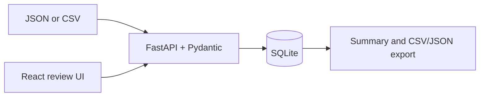

# AI Response Evaluation and Quality Benchmarking Platform

A local-first portfolio project for comparing two AI responses against an explicit, versioned rubric. It supports synthetic examples, validated JSON/CSV imports, persisted ratings, written rationales, uncertainty and safety flags, filtering, summary metrics, and CSV/JSON exports.

This is an independent portfolio project. It is not affiliated with Handshake or any AI research lab. Synthetic results demonstrate application behavior only; they do not establish model quality or improvement.

## Current status

- [x] Initial product requirements and MVP
- [x] Backend and local database vertical slice
- [x] React/TypeScript review interface
- [x] Synthetic example set
- [x] Unit and workflow tests run (9 passed)
- [x] Frontend production build verified
- [x] Search/filter, disagreement review, and adjudication notes
- [x] Local API smoke check for import, evaluation, disagreement, adjudication, and CSV export
- [ ] Deployment
- [ ] GitHub publication

## Requirements and architecture

The MVP lets an evaluator import prompt/response pairs, compare A and B, rate five dimensions from 1–5, select A/B/tie/unable-to-judge, enter a required rationale, and inspect sample counts and exports. FastAPI validates requests with Pydantic; SQLite stores records and evaluation history; the React UI calls the API. The rubric weights are correctness 40%, instruction adherence 25%, completeness 15%, evidence quality 10%, and clarity 10%.



## Run locally

Use Python 3.12 and Node.js 22 or compatible versions. Copy `.env.example` to `.env` if you need to change `DATABASE_PATH`; the shipped default writes the local SQLite database. The dotenv file is loaded by the API and must remain uncommitted.

### Backend

```powershell
cd ai-response-evaluation-platform
python -m venv .venv
.\.venv\Scripts\Activate.ps1
pip install -r requirements.txt
uvicorn app.main:app --reload
```

API documentation is available at `http://127.0.0.1:8000/docs`. Health check: `GET /api/health`.

### Frontend

In another terminal:

```powershell
cd ai-response-evaluation-platform\frontend
npm install
npm run dev
```

The Vite development server proxies `/api` requests to the local API. Keep both processes running while using the interface.

## API examples

Import JSON with `POST /api/items/import`:

```json
{"records":[{"id":"demo-1","topic":"general","prompt":"Answer in one sentence.","response_a":"A concise answer.","response_b":"A different answer."}]}
```

Create an evaluation with `POST /api/evaluations`; each score is an integer from 1 through 5 and the justification must be at least 10 characters. Update the active rubric with `PUT /api/rubric`; weights must sum to 1 and its version is saved with each evaluation. Browse `/docs` for the full schema.

## Verification

Run `python -m pytest -q` from this directory. The actual local results and smoke-check scope are in [`docs/test-report.md`](docs/test-report.md). Build the UI with `npm run build` from `frontend/`.

## Limitations and future work

The active configurable rubric is held in memory and resets to v1.0 when the API process restarts; the rubric version and scores are stored with each evaluation. This release has no authentication, pagination, or production deployment configuration. Evaluator IDs are pseudonymous labels, not verified identities. The summary reports counts, not statistical claims about models. See [`docs/evaluation-methodology.md`](docs/evaluation-methodology.md) for scoring and limitations.

See [`docs/requirements.md`](docs/requirements.md) for MVP acceptance criteria, [`docs/architecture.md`](docs/architecture.md) for data flow, [`docs/demo.md`](docs/demo.md) for a short walkthrough, [`docs/response-quality-examples.md`](docs/response-quality-examples.md) for labeled cases, and [`docs/deployment.md`](docs/deployment.md) for the current hosting assessment.

## License

MIT License. See `LICENSE`.

