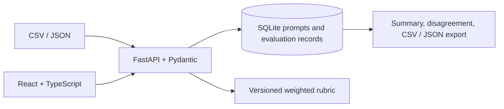

# Architecture

The API is the validation and scoring boundary. Import requests are schema-checked before insertion. Evaluation requests persist per-dimension ratings, choice, rationale, flags, timestamp, pseudonymous evaluator ID, and rubric version. Aggregates and exports are derived from saved records. The rubric's active weights currently live in process memory; evaluations preserve the version string and component scores.

This single-process SQLite architecture is intended for local demonstration. It has no authentication, role model, migrations, distributed locking, or durable cloud storage configuration.
